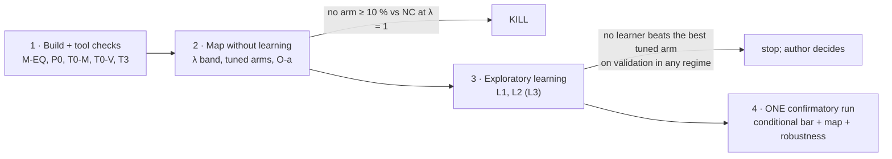

# Day-pattern corridor testbed: regime map and conditional-bar test (protocol v0, DRAFT for design review)

*2026-10-11 · branch `claude/day-pattern-core` · decisions D5.6 (testbed path), D5.8 (conditional bar), D5.10 (BN4 result) · **draft: not binding until the author approves it after its design review; no stage runs before the approved version is committed***

## 0. Purpose, scope and lessons built in

**Question.** On a declared synthetic "U.S.169-like" corridor, does a learning-based ramp-metering controller (DRL alone or a proven controller helped by a neural network) beat no control by ≥ 10 % and beat the best tuned proven controller in identifiable regimes (D5.8)?

**Scope sentence** (stated verbatim with every result): *"On a METANET model of U.S.169 SB calibrated to 22 days of 2023 data but not validated (protocol v5 stopped at the in-sample screen: B1 jams on 16 of 22 calibration days against 22 of 22 in reality), driven by demand days generated from those 22 days."*

**Not in scope.**
- No realism claim.
- The 97 v5 validation days stay unlooked, so that a later realism gate stays possible.
- No 2024 data, no SUMO.

**Lessons built in.**
- **From BN4 (R6+, Addenda G–I):**
	- strong simple baselines (constant and time-of-day rates) are mandatory;
	- the DRL recipe that won: a strong lever, a small discrete action set, slow decisions, reward = the judged metric, memory, and enough training;
	- the bar is a regime map, not a universal number.
- **From the literature:** on a real corridor, an informed optimum beats good feedback by only ≈ 2–9 % (Frejo & De Schutter 2021, Seville). So wins over tuned control are expected mainly in disturbance or atypical regimes, and stage 2 is designed to KILL early and cheaply.

## 1. Plant (frozen)
- **Plant:** the v5 nominal (restart 7,192,011; `frozen_params` in `docs/lab/day_pattern/metanet_v5_calibration.json`, SHA-256 recorded when this protocol is committed). v4 network: 39 cells, T = 0.75 s. Deterministic: c1 = c2 = 1, no F1.
- **Model-mismatch variant** (report-only robustness row): restart 7,192,017 (J5 0.3564).
- **MPC model** (§4): restart 7,192,014 (J5 0.3522). It is fitted on the same calibration data but is not the plant, so the MPC never gets the true model.

## 2. Controlled mode (stage-1 build; new files only, no edit to a v5 `CODE_PATHS` file)

**Stepper.** `vsl_lab/plants/metanet_ctrl.py` is a state-in, state-out stepper.
- It reproduces `simulate()` bit for bit in replay. Check **M-EQ**: relative difference ≤ 1e-12 on every output of the 22 calibration days.
- Control period Δc = **60 s** (80 steps) for every arm, learning or not.

**Meters** at the 4 controlled ramps, E9, E12, E13 and E14 (M169S51/54/55/56; v3 R13(a)):
- q_o,i = min(d_i + w_i/T, Q_O, supply, r_i), with r_i ∈ [240, 1,714] veh/h. These are the SZM release limits (MnDOT MN/RC 2005-48 [VERIFY]).
- **Queue override** (v3 R1(b); identical for every arm): if w_i ≥ S_i, or the estimated wait w_i / r_i ≥ 240 s, the ramp releases at Q_O for that control period. The minutes with the override active are reported per arm.
- **Storage** S_i (veh) = storage × 0.3048 × storage lanes / s_jam (v3 R1(a)).
	- storage: 300 / 450 / 500 / 420 (IRIS, feet [VERIFY]);
	- storage lanes: from the IRIS config;
	- s_jam: from a source cited before stage 1;
	- a ±25 % sensitivity is reported.

**VSL** (optional actuator, kept only if T0-V passes, §5): speed limits on the B1 area (km 1.06–2.56; v3 R6) in the Hegyi min form with α = 0.1, b ∈ {60, 70, …, 120} km/h. Every VSL result states that the VSL response is assumed, not validated (v3 R6).

**Demand**
- **Controlled ramps:** Queue-detector arrivals (E9 3663, E12 7103, E13 5426, E14 5431).
	- Each ramp-day is checked with P0 (v3 R1(c)): |Σ arrivals − Σ release| ≤ 5 %, and the reconstructed queue within [0, 1.2 S_i] in ≥ 95 % of bins.
	- A ramp-day that fails uses its Passage replay as demand and is listed.
	- E14 already replays its Queue detector, so P0 is not informative for it.
- **E1–E6:** replayed (exogenous, identical for every arm).
- **E7, E8, E10, E11:** served counts (zero uplift is primary; the v3 R2 uplift is a sensitivity).
- **E15** and **d0:** as in v5.

**Outputs** per 5-min bin:
- vehicle-hours in the mainline cells;
- every origin queue (the mainline and 15 ramps);
- served vehicles;
- the override minutes;
- the B1 and B2 episodes (EA-2 event layer with the observation operator; v3 R13(d)).

**Field arm** (report-only): r_i(t) = the ramp's Passage replay, i.e. the field meter's open-loop output, with demand = Queue arrivals.

## 3. Day library and regimes

**Source days:** the 22 v5 calibration Wednesdays only. They are split by date order, cycling train, train, validation, train, test, train, and so on, so that each split covers the year:
- **12 train-source** days (tuning and training);
- **4 validation-source** days (checkpoints and candidate choice);
- **6 test-source** days (stage 4 only).

The exact day lists are written into the approved version.

**Generator g(source day, seed)**, applied to every demand series alike. The formulas are fixed in the approved version:
1. a demand scale λ (§3.2);
2. a PM-peak time shift ~ U(−30, +30) min;
3. a peak stretch ~ U(0.9, 1.1) about the peak centre;
4. multiplicative lognormal noise, 5 % per 5-min bin;
5. a disturbance per regime:
	- **incident:** one lane closed in one cell, chosen uniformly in cells 24–34 (ρ_cr and the lane count scaled by (λ_c − 1)/λ_c). Start ~ U(06:00, 20:00), duration ~ U(15, 60) min;
	- **slowdown:** v_f × 0.7 on G3 for U(30, 90) min (weather-like).

**Demand band (stage 2):** λ ∈ {0.85, 0.90, …, 1.15}. The realistic level is **λ = 1**, the only headline (the refined λ rule).

**Regimes, pre-registered for stage 4, all at λ = 1:**

| Regime | Source days | Disturbance |
|---|---|---|
| R-B1 | days not heavy at B2 (13 of the 22) | none |
| R-both | days heavy at both heads (9 of the 22) | none |
| R-inc | any | incident |
| R-slow | any | slowdown |

**Report-only rows (robustness):**
- one point inside the λ band and one high-λ point;
- the mismatch plant 7,192,017;
- **held-out severities:** incidents of 60–120 min, slowdowns × 0.5.

## 4. Arms

**Non-learning** (one parameter set per arm, tuned on train-source instances with the tuning seeds and a common budget, as in roadmap §0):
- **NC:** no metering, no VSL.
- **FIELD:** report-only (§2).
- **CONST-TOD:** a constant rate per ramp and period (06–10, 10–15, 15–19, the rest), tuned by coordinate descent over {240, 400, …, 1,714} veh/h.
- **ALINEA** (density form; Papageorgiou et al. 1991 [VERIFY]), per ramp: r ← r + K_R (ρ* − ρ_s).
	- ρ_s is measured at the first real-station cell downstream of the merge (v3 R13(b)): E9 → 21, E12 → 25, E13 → 32, E14 → 35 (1-based).
	- (K_R, ρ*) is tuned on a grid; the override applies.
- **HERO:** ALINEA locally, plus queue-balancing coordination (Papamichail et al. 2010 [VERIFY]).
	- B1's head ramp E13 is master, with E12 and then E9 recruited as slaves; B2's head ramp E14 is master, with E13 recruited (v3 R13(c)).
	- Activation and release thresholds are tuned.
- **MTFC-VSL + ALINEA:** only if T0-V passes. Carlson cascade on B1 (Carlson et al. 2011, 2014 [VERIFY]).
- **MPC-E** (enumeration MPC, non-learning):
	- every 5 min it evaluates 3 rate levels per controlled ramp over 15 min (81 joint plans, in one vectorised batch);
	- its model is METANET with restart 7,192,014's parameters;
	- its demand forecast is the median train-source profile, scaled by the λ estimated from the last 30 min of upstream counts;
	- it applies the first 5 min of the best plan.
	- **Cost cap:** if one day takes > 60 s per core, it is reported but not tuned further.
- **O-a** (report-only bound): the per-regime-tuned best of CONST-TOD and ALINEA, chosen on the test instances (cheats on purpose). It gives the **adaptation gap** per regime.

**Learning** (stage 3; trained on train-source instances, candidates chosen on validation-source instances only):
- **L1, plain DRL (the BN4 recipe):** RecurrentPPO.
	- **Observation:** the 17 stations' 5-min flow and speed, the 4 ramp queues, the time of day, the previous action.
	- **Action:** MultiDiscrete(4 × 8 rate levels) every 60 s, with the override active.
	- **Reward:** −Δ(vehicle-hours in the system, origin queues included) / normaliser.
	- **Episode:** one generated day (05:00–23:00, 1,080 decisions).
	- **Budget:** 2,000 updates × 16 envs; 3 learner seeds; the C1 convergence check.
- **L2, supervised helper:** a small LSTM regime classifier that, every 15 min, picks one of the stage-2 per-regime-tuned ALINEA or CONST-TOD sets. It imitates O-a's labels on train-source instances.
- **L3, DRL hybrid** (R6-type: RecurrentPPO picks the ALINEA/HERO parameter set): **optional**, an author item.
- **Candidate:** the best validation score among L1–L3, frozen before stage 4.

## 5. Stages, checks and KILL points

**Stage 1 criteria (fixed here):**
- **M-EQ** as in §2.
- **P0:** valid on ≥ 80 % of ramp-days, otherwise the v3 R1 fallback.
- **T0-M:** on ≥ 3 heavy train-source days, cutting E13's rate from 1,714 to 600 veh/h lowers the B1 head inflow and changes J by > 1 %.
- **T0-V:** b = 60 km/h on the B1 area lowers the B1 head inflow by > 3 % on those days. Otherwise VSL is dropped (disclosed).
- **T3:** identical outputs on a re-run.

**Stage 2 KILL (the `CLAUDE.md` early KILL):** if neither the best tuned arm nor O-a beats NC by ≥ 10 % (median paired difference, train-source tuning instances, λ = 1), stop the testbed. The adaptation gap (O-a vs the best single-tuned arm) and the λ band are reported per regime.

**Stage 4 bar (D5.8). PASS only if all hold:**
1. the candidate beats NC by ≥ 10 %, pooled over the four regimes (CI upper bound < 0);
2. in ≥ 1 regime it beats B_k, the tuned non-learning arm with the lowest median J in that regime (CI level 1 − 0.05/4);
3. in no regime is it worse than B_k by > 5 % with the Bonferroni CI lower bound > 0;
4. its override-active minutes are ≤ 1.1 × B_k's.

**Report-only:** the operating map (the candidate and every learner vs every arm, per regime) and the robustness rows (§3).

## 6. Metric
- **Primary J:** total delay in veh·h, i.e. Σ (time in the system, mainline and origin queues included − free-flow time), from 05:00 until the drain ends.
	- After 23:00, demand is held at 0.
	- The drain is capped at 2 h; any undrained remainder is counted at the cap.
- **Co-headline:** vehicles served by 23:00.
- **Side measures (reported):** per ramp, the maximum and 95th-percentile wait and the override minutes; the B1 and B2 episode statistics (v3 R13(d)); per-ramp delay, for equity.
- **rel** = median paired Δ / the comparator's median J.

## 7. Statistics
- **Unit:** the test instance (source day × generator seed × regime), paired across arms with common random numbers.
- **Primary CI:** percentile bootstrap over instances, 10,000 resamples. A cluster bootstrap over the 6 test-source days is also reported; it is coarse, and the claim is worded for the generator's day population.
- **Regimes:** Bonferroni 1 − 0.05/4.
- **One look** at the test instances.

## 8. Seeds (author approval needed before stage 1)
- **Block 7,193,000–7,193,999:**
	- 000–009 smoke;
	- 010–099 plant checks;
	- 100–299 tuning instances;
	- 300–499 validation instances;
	- 500–699 test instances (stage 4);
	- 700–999 reserved.
- **DRL training generator seeds:** 7,280,000–7,289,999.
- A grep finds these prefixes only as coincidental numbers inside result JSON files, never as used seeds.

## 9. Compute and reviews
- **METANET speed:** ≈ 0.15 s per simulated day per core, batched. The single-instance stepper with control callbacks is unmeasured; it is timed in stage 1.
- **Rough estimates:**
	- stage 2 is a few CPU-hours;
	- L1 training: 2,000 updates × 16 envs × 1,080 decisions ≈ 35 M decisions per learner, which is hours per learner if a day costs ≤ 5 s;
	- stage 4 ≈ 1 h.
- **Reviews:** this design review (ultracode), and one code checkpoint before stage 3's long runs (ultracode). Nothing else.

## 10. Author items
1. The seed blocks (§8).
2. VSL in or out, if T0-V passes (the title's "speed harmonisation").
3. L3 in or out.
4. The regimes (§3) and the drain rule (§6).
5. s_jam's source.
