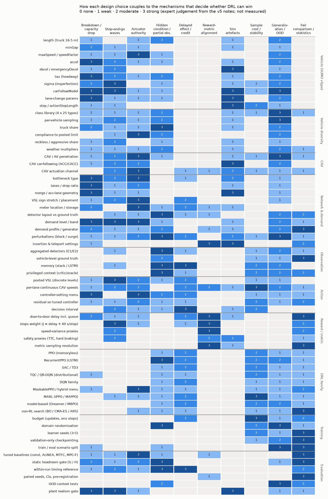
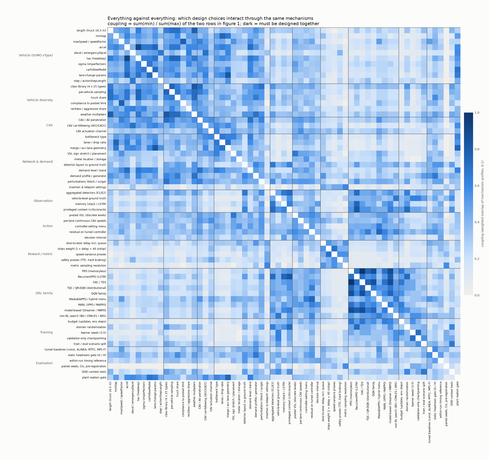
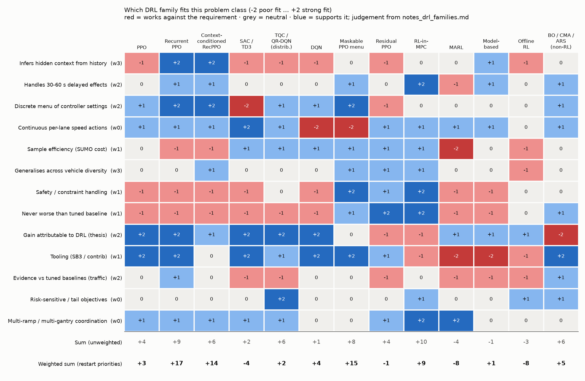
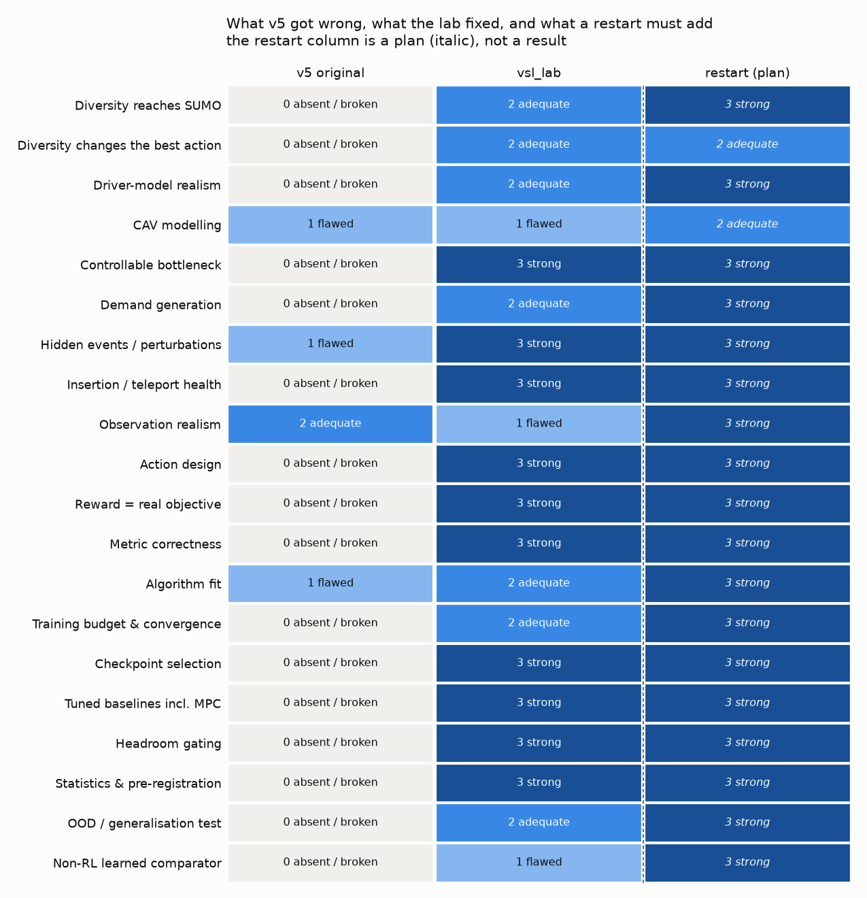

# Design space for a DRL restart: what v5 teaches, and which DRL family to use (v0)

*2026-10-04 · desk study, no simulation run · built from five notes in this folder, each citing file:line in the v5 repo and docs:*
- *`notes_vehicles.md`;*
- *`notes_networks.md`;*
- *`notes_rl_design.md`;*
- *`notes_history.md`;*
- *`notes_drl_families.md`.*

*All heatmap scores are judgements grounded in those notes, not measurements. `build_heatmaps.py` regenerates every figure and `tables.md`; the table view lists each score with its one-line rationale.*

## 1. Bottom line

1. **The per-vehicle diversity idea was sound, but it never reached the controller in v5.**
   - `vehicle_fleet.py` built a 100-type library (4 classes × (10 normal + 10 reckless + 5 CAV)). The headline runs were 100 % CAV, so no human type was ever spawned.
   - The documented compliance model is dead code, and only desired speed and car-following noise vary per vehicle.
   - Evaluation ran in clear weather only, while training mixed in rain and fog.
   - **The adaptability the diversity was meant to force was never exercised** (`notes_vehicles.md` §3, §6).
2. **When the lab did test heterogeneity as a hidden condition, it bought little headroom:**
   - compliance share: G = 0.8 %;
   - truck share: G = 4.0 %, the largest of any family;
   - "driver-population class" (tau, accel, lane-change style together) was **never tested**.
   - Diversity creates room for DRL only if it **changes the best action and cannot be measured directly** (figure 1, column M4).
3. **Distributional RL (TQC) was a design argument that no experiment supported:**
   - It was chosen for a bimodal breakdown regime that the capped evaluation never reached.
   - The CVaR evaluation was never implemented.
   - Each 1 M-step run made only 20.6 k gradient steps, with flat learning curves.
   - No traffic paper found shows a distributional-RL gain on freeway, ramp or CAV control.
   - A distributional critic models the spread of returns; it does not infer the hidden context, which is this problem's real difficulty (`notes_drl_families.md` §3).
4. **Recommended family: a recurrent on-policy actor-critic that infers the hidden context.**
   - Use RecurrentPPO, made context-conditioned: domain randomisation over vehicle populations, a privileged critic, and an auxiliary context-prediction head.
   - It acts on a **discrete menu of tuned controller settings**, which is R6's action design.
   - **MaskablePPO over the same menu** is the hybrid variant.
   - **ARS / BO / CMA-ES** are co-primary comparators: they falsify "deep learning was needed".
   - Weighted fit (figure 3): RecurrentPPO +17, MaskablePPO menu +15, context-conditioned RecurrentPPO +14, RL-in-MPC +9, … TQC/QR-DQN +2, SAC/TD3 −4, MARL −8, offline RL −8.
5. **No family creates headroom; the gate still comes first.** The restart should be framed as **R6's generalisation problem**: can a context-inferring policy keep R6's 2.5–4.3 % edge when vehicle populations and perturbation severities vary, including held-out ranges? R6 lost that edge out of distribution (+16 % on surges). This builds on the project's only confirmed win.

## 2. The four figures

| Figure | What it shows | How to read it |
|---|---|---|
|  **fig1** | 63 design factors in 10 groups (SUMO vType parameters, diversity, CAV, network and demand, observation, action, reward, DRL family, training, evaluation) × 10 mechanisms that decide whether DRL can win | 0–3 coupling strength. Read a column to see which choices control a mechanism; read a row to see what a choice affects. |
|  **fig2** | Every factor against every other factor | Weighted overlap of two rows of fig1 (Σmin / Σmax). Dark means the two choices act through the same mechanisms, so they must be designed together. It is **not** a direct causal link: length and weather couple at 0.78 because both act through hidden conditions and OOD, not through each other. |
|  **fig3** | 13 families (11 RL, RL-in-MPC, non-RL search) × 13 requirements, −2…+2 | The weights (w0–w3) reflect the restart's priorities and were stated before ranking. Continuous per-lane actions, tail objectives and multi-ramp coordination get w0 because they are not in the restart design. |
|  **fig4** | 20 design aspects: v5 original → vsl_lab → restart plan | The lab already fixed most of v5's flaws. What remains: diversity as a tested hidden condition, OOD tests, and non-RL learned comparators. |

Colours follow the dataviz reference palette: one-hue blue ramp for magnitude, and blue↔red with a grey midpoint for fit. All ramps passed the dataviz validator (`node scripts/validate_palette.js --ordinal`).

## 3. What the factor × mechanism map says

- **Mechanism load** (column sums of fig1):

  | Mechanism | Load |
  |---|---|
  | OOD generalisation | 88 |
  | Hidden condition | 72 |
  | Fair comparison | 72 |
  | Waves | 68 |
  | Authority | 67 |
  | Capacity drop | 65 |
  | Artefacts | 51 |
  | Delay | 47 |
  | Sample cost | 47 |
  | Reward alignment | 25 |

  Generalisation and fair comparison are where most design choices bite. Those are exactly where v5 broke and where R6 is still weak.
- **SUMO vehicle parameters act mainly through the plant**, not through hidden information:
  - accel, tau, carFollowModel and lane-change parameters load on capacity drop, waves and artefacts.
  - Only **tau, length/truck share and compliance** load strongly on the hidden-condition column, so they are the parameters that can make adaptivity pay.
  - **So diversity has two jobs that must be designed separately:** (a) make the plant realistic (a capacity drop and waves without artefacts), and (b) create hidden conditions that move the best action.
- **Network choices decide whether there is anything to control:**
  - Bottleneck type, drop ratio and demand band all score 3 on capacity drop and authority.
  - Only zipper nodes gave an artefact-free capacity drop: BN4 13.8 %, ZM3 3.3 %. Acceleration-lane merges gave none (ramps_v1 −0.4 %).
  - The demand band is narrow (LD3: one of four levels).
- **Reward and metric choices barely touch the plant, but they are the most gameable** (M6). v5's speed-variance reward earned +221 while TTS got 23 % worse.

## 4. The strongest couplings (fig2) and what to do about them

| Pair | Coupling | Design consequence |
|---|---|---|
| privileged context ↔ RecurrentPPO | 0.82 | The context-conditioned design is one package: memory, privileged critic and context head together. |
| lane-change params ↔ merge geometry | 0.82 | Tune merge behaviour and geometry together inside the realism gate. lcAssertive moved breakdown to the network entry. |
| maxSpeed/speedFactor ↔ compliance | 0.78 | Model compliance as a desired-speed distribution (the lab's normc pattern), not a binary flag. |
| tau ↔ truck share, tau ↔ per-vehicle sampling | 0.75 | Define **driver-population classes** (tau, accel, minGap, sigma, lane-change) as the untested hidden condition, sampled per vehicle. |
| minGap ↔ drop ratio; merge geometry ↔ realism gate | 0.75 | Capacity is set jointly by vType and geometry: gate every plant, including BN4, which was never gated. |
| residual ↔ MaskablePPO menu | 0.75 | Both are "baseline-inside" hybrids. Choose one; the menu is the safer of the two (the LD3 residual degraded during training). |
| memory ↔ RecurrentPPO; detectors ↔ RecurrentPPO | 0.73–0.75 | With realistic loop detectors (not BN4's ground-truth counts), memory is what recovers the hidden state. |
| class library ↔ CAV penetration | 0.71 | Penetration changes which types exist. Draw CAV assignment so that arrivals are identical across penetration levels (the lab pattern). |

## 5. Lessons from the diversity attempt (specific to it)

1. **Diversity must reach SUMO.**
   - Assert it in a health check: count spawned vehicles per type and population class in every run.
   - v5's library was silently inert.
2. **Heterogeneity without a hidden-condition effect is just noise.** Measure a static G and a within-run G for each diversity axis *before* training. Truck share is the best measured axis so far (4.0 %); driver-population class is untested.
3. **Keep training and evaluation in the same distribution, and test held-out ranges on purpose.** v5 trained on rain and fog and evaluated in clear weather. R6 trained on one perturbation mix and failed outside it.
4. **CAVs are a separate axis with their own artefacts.**
   - SUMO's default CACC added 46–93 % delay at 25 %.
   - A 0.5 s step produced emergency-braking artefacts.
   - Use CAVs only after an authority check, at a 0.1–0.2 s step.
5. **Never disable teleports or insertion checks to hide problems.** v5 ran with `--time-to-teleport -1` and `insertionChecks="none"`.
6. **One distribution mechanism, declared in one place.**
   - v5 hard-coded the fleet with no config.
   - The lab's `vTypeDistribution` plus `normc` desired speeds, with a fixed truck share, is the pattern to keep.
   - Whether SUMO samples other vType attributes from distributions natively is [VERIFY]. If it does not, generate many sampled vTypes per class.

## 6. DRL family choice

**Recommended** (`notes_drl_families.md` §6; fig3):
- **R1. Context-conditioned RecurrentPPO** (sb3-contrib).
  - Build it as an ablation ladder: plain RecurrentPPO (R6 config) → + domain randomisation → + privileged critic → + auxiliary context head.
  - The context head is a **diagnostic**: if it cannot predict the hidden class from history, the "history carries information" argument fails for that cell.
  - Main risk: broad randomisation may cost the 2.5–4.3 % in-distribution edge.
- **R2. MaskablePPO over a menu of BO-tuned controller settings,** with masks enforcing the ramp-queue limit. The baseline is inside the action set.
  - Main risk: reviewers credit the controller.
  - No recurrent version exists in contrib [VERIFY], so memory plus masks needs custom code.
- **R3. Non-RL policy search as co-primary comparator:** BO/CMA-ES tuning of every baseline with the **same simulation budget**, plus ARS with a linear policy on the same features and filtered history. If ARS matches R1, the DRL claim for that cell is gone. That is better learned early.

**Not recommended for the restart:**
- **Distributional RL.** Revisit only if a pre-registered *tail* objective becomes primary, e.g. P(breakdown); then use QR-DQN/IQN with CVaR action selection on a small menu.
- SAC/TD3, model-based, offline RL, transformers, and MARL (MARL only for multi-ramp corridors).

**Scope note.** The family-research agent applied the v6 exclusions and cited no VSL papers. The VSL literature is covered separately by `../drl_vsl_reality_check_v0.md`. VSL itself is allowed in v5.

## 7. Restart blueprint (each step can kill the restart)

| Step | What | Kill / gate |
|---|---|---|
| S0 | Fix the trainer: RecurrentPPO and TRPO ignore `--lr-decay` (`train_sb3.py:229, 235`); enforce the convergence rule (R6's final policies were 6.7–10.7 % worse than their best checkpoint, with entropy collapse) | none |
| S1 | Plant: the zipper family (BN4, ZM3) with **loop detectors, not ground-truth counts**. Run BN4 through the realism gate, which has never been done | Capacity drop and discharge criteria; metering authority with loops |
| S2 | Vehicle populations: per-vehicle sampled classes (tau, accel, minGap, sigma, lane-change, normc speedFactor), truck share, compliance. Pre-register training ranges and **held-out** ranges | Health check that every class is spawned |
| S3 | Headroom over populations × perturbations: static G/H **and** a within-run timing reference (best setting per 5-min block in hindsight) | Kill if both are < 10 % (CI) |
| S4 | Comparators: tuned constant, ALINEA/PI-ALINEA, event scheduler, MPC-F, BO-tuned with equal budget, linear ARS on the same features | Frozen before any DRL run |
| S5 | DRL: the R1 ladder and R2. 3–5 learner seeds, ≥ 500 updates (R6 used 2,000), validation-only checkpoints | Screening on validation seeds |
| S6 | Confirmatory: paired CIs on reserved seeds, **in-mix and held-out contexts** reported separately; context-head accuracy as a diagnostic | R6's claim rule: CI below 0 against every tuned comparator |

## 8. Limits

- The scores are judgements. Two reviewers would differ by ±1 on many cells; the rationales in `tables.md` make each one checkable.
- Fig2 is derived from fig1's profiles. It shows shared mechanisms, not measured interactions.
- Literature items in `notes_drl_families.md` are mostly [ABSTRACT]/[SNIPPET] and marked [VERIFY]; six papers were read in sections.
- The SUMO semantics listed in `notes_vehicles.md` §8 are unverified, e.g. `slowDown` re-issue behaviour and vType distribution support.

## 9. Files

- **Figures:** `fig1_factor_mechanism.png`, `fig2_factor_coupling.png`, `fig3_family_fit.png`, `fig4_status.png`.
- **Data:** a CSV for each figure, and `tables.md` as the text view.
- **Code:** `build_heatmaps.py`, which needs matplotlib. Palette checks: `node <dataviz>/scripts/validate_palette.js --ordinal`.
- **Notes:** the five `notes_*.md` files.
- **Tooling installed for this study:** Node.js v24.21.0 (npm 11.19.0), user-level in `~/.local/opt/node-v24.21.0-linux-x64`, with `node`, `npm`, `npx` and `corepack` linked in `~/.local/bin`. The download was checked against the official SHASUMS256.
