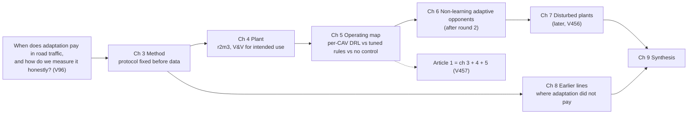

# Thesis outline v1 and claim (approved V459, 2026-11-07)

Replaces `docs/roadmap/thesis_roadmap_v0.md` (V129). The claim review (ultracode) runs after round 2 (V459). Binding inputs: V95, V96, V245, V256, V402, V456, V457, V458. Title (fixed): "Adaptive driving algorithms for intelligent road traffic systems". Submission about September 2027.

The claim sentences in §3 are fixed **before round 2's data** (expected 2026-11-08). Rounds 1, confirmatory 2, 3 and 3b and the demand sweep are already known, so the bar in §3 is set after those results; this is disclosed.

## 1. The story in one picture

## 2. Research questions and contributions

| RQ | Question | Contribution | Evidence now | Status |
|---|---|---|---|---|
| RQ1 | What must a microsimulation plant satisfy before it can support conclusions about per-CAV control, and does r2m3 satisfy it? | C1: a V&V record for r2m3 (`plant_c3`) against its intended use: requirements, method per requirement, evidence, traceability matrix, numbered limits. "Verified and validated" is used only after the record is reviewed and PR-15, PR-24 and PR-28 are closed (V462) | 501 tests, T0/T1/T3, smoke checks, baselines v0-v4, parameter sources; gaps V367, V283, V387 | record to build (step 3) |
| RQ2 | How should learning and tuned rule controllers be compared so that a claim survives fresh seeds, stronger opponents and step-resolution safety metrics? | C2: an evaluation protocol, with the thesis's own ledger showing where each element changed a conclusion | V244 (gate without a null), V256 (plant artefact), V367 (braking hidden at 1 Hz), V401 (no replication on fresh seeds), V405 and V452 (overstatements corrected) | material exists |
| RQ3 | Where, on which measures and by how much does per-CAV DRL beat, tie or lose against tuned rules and no control? | C3: a two-cell decision map on r2m3 (X1, X2 at 5,300) with report-only band and history panels (V462) | phase 1 tie (r1m3 P0); confirmatory 2, 1 of 20 cells (V359); confirmatory 3/3b, X2 not replicated (V401); round 1, v3w won T2 against the old grid (V449, V452); sweep (V409) | round 2 decides (§3) |
| RQ4 | Does a non-learning adaptive controller (MPC with a model fitted on separate seeds, adaptive scheduler) match DRL here? | C4: learning versus adaptation, same plant | none | protocol after round 2 (V457) |
| RQ5 | Does the answer change when the plant is disturbed? | C5: disturbance study, each disturbance fixed before control results | none | later (V456) |

No "first" or "novel" in any of these. Literature in chapter 2 marked [VERIFY] until read in full.

## 3. The claim

**Thesis claim (template, filled after round 2; wording amended after round 2's validation rows existed and before any test row, V462, V463):** "On a synthetic freeway plant documented in a V&V record for comparing controllers that set ALKS time headways (r2m3), within its limits L1-Ln, and under a protocol fixed before data, these per-CAV PPO policies [outcome W, G or N below, one sentence per cell] against the rule controllers, and [outcome below] against no control. A two-cell decision map with report-only band and history panels is reported in full."

Every outcome sentence carries confirmatory 3's model sentence and its "What this cannot show" items, and round 2's, verbatim (`confirmatory_3.md`, `round_2.md` "Sentences allowed").

**Bar against tuned rules = round 2's T2 reading** (`round_2.md`, the strongest pre-registered reading on record), with the D10 rules unchanged:

| Outcome | When | Sentence the thesis may use |
|---|---|---|
| W | v3w or a finalist wins T2 in a cell where a CMA-ES rule (3E) counts | "In [cell], these per-CAV PPO policies had [x] % less close-following [CI] than every counting rule (p333 fixed, the others tuned on separate seeds), including [3E-X: a rule tuned by CMA-ES for this cell on separate seeds \| 3E-T: a rule tuned by CMA-ES under the training slowdowns, not for this cell], with delay, flow and the other side measures within the pre-registered limits; it tied or lost elsewhere: [map]." |
| G | wins only against the grid, no counting 3E rule beaten | "Won against confirmatory 3's grid, not against the CMA-ES rule [name]: [limits missed]." No margin against the grid in the sentence; no sentence says DRL beats tuned rules. |
| N | no T2 win where a 3E rule counts | "On this plant, these per-CAV PPO policies (v3w[, finalists]) did not beat the strongest counting rules; the DRL claim against tuned rules closes in [cells]." Round 1's win against the grid alone is reported beside it. Accepted as a result (V456). |

**Bar against no control (V459):** delay at least 10 % lower with the CI excluding 0 (the method's early-KILL bar) **and** close-following not harmed under round 2's harm rule. Without the second part, a delay gain bought with more close-following would count as a win (V405: in X1 the confirmatory-3 policies had 31 % more close-following than no control; V449: in round 1's X1 every v3w policy had more close-following than no control, which had 39 % more delay). Confirmatory 3's no-control clause, filled from T2 (no control's TTC, delay and braking; its per-policy wording when it triggers; the collisions sentence), is carried beside this reading (V462).

**Map tiles (V462):** win, tie or lose per cell, measure and opponent at 95 %, descriptive only; only T2 and the V459 bar decide. Rows outside the plant's intended use (band, 3E-T's condition T, panel C's H1 and H2) say so.

**What the claim never says:** "proven"; "verified and validated" before the record is reviewed and PR-15, PR-24 and PR-28 are closed (V462); "safe" without the severe-conflict check; results on calibrated or field traffic; any win on a measure that was not pre-registered.

## 4. Chapters

| Ch | Working title | Content | Sources | Status |
|---|---|---|---|---|
| 1 | Introduction | question, scope, RQ1-RQ5, contributions, ARC-IT framing [VERIFY codes] | §2-§3 here | to write |
| 2 | Literature Review and Theoretical Background (V484) | freeway control (VSL, metering, CAV control), DRL in traffic, reported gains (prior about 1.5-6 % [VERIFY]), PhD theses reviewed, evaluation practice; open implementations reviewed against their evidence, with a replication programme (`sec:open-impl`, drafted) | `docs/research/lit_reviews/`, `literature_v0.md`, `prior_art_*` | material partly, to write |
| 3 | Method: comparing learning and rules honestly | pre-registration, paired seeds, median paired difference, percentile bootstrap, Bonferroni, harm and non-inferiority, early KILL, fresh seeds per round, the bug rule, metric traps (V244, V283, V294, V367, V386) | protocols, decisions ledger, memories on metric traps | material, to write |
| 4 | The plant and its V&V record | r1m3 and r2m3, drivers (HDV, CAV, ALKS), actuators, sensors, slowdowns; requirements, verification, evidence, traceability, limits; MnDOT sanity comparison (not a calibration) | `docs/architecture/`, `docs/testing/`, parameter sources | step 3 |
| 5 | Per-CAV DRL against tuned rules: the operating map | phases 1-3, confirmatory 2/3/3b, rounds 1-2, demand sweep; win, tie or lose per cell and measure; no control in every table | results and reports folders | round 2 pending |
| 6 | Learning or adaptation? | fitted-model MPC, adaptive scheduler on the same plant | after round 2 | planned |
| 7 | Disturbed plants | disturbances fixed before control results | later | planned |
| 8 | Earlier lines: where adaptation did not pay | line #1 safety margin on real trajectories, valid but no win (V85); mainline metering on a realistic capacity drop, KILL (V149); mobility results withdrawn as a plant artefact (V256) | archive branches | done, to write |
| 9 | Synthesis and conclusion | when adaptation pays on this evidence; limits of simulation evidence; future work | all | to write |

## 5. Papers (target 2)

- **Article 1** = plant + method + operating map (ch 3-5, V457). Drafting starts now; results section filled after round 2.
- **Paper 2:** chosen after round 2. Candidates: ch 6 (learning or adaptation), ch 7 (disturbed plants), or a methods paper from ch 3 + 8.
- Still unknown (open since V129): whether the university needs the papers submitted, accepted or published before the thesis.

## 6. Order of work (author time is the bottleneck; compute is not)

1. Claim review (ultracode) after round 2 (V459).
2. Plant V&V: requirements list mapped to evidence and gaps (V&V target: r2m3 `plant_c3`).
3. Article 1 skeleton: sections, figure and table list, each tied to a stored result.
4. Round 2 result (session 3c) fills §3 and chapter 5.
5. Chapter 3 and 4 drafting in LaTeX; parallel track (ch 6) protocol once the CPU is free.
